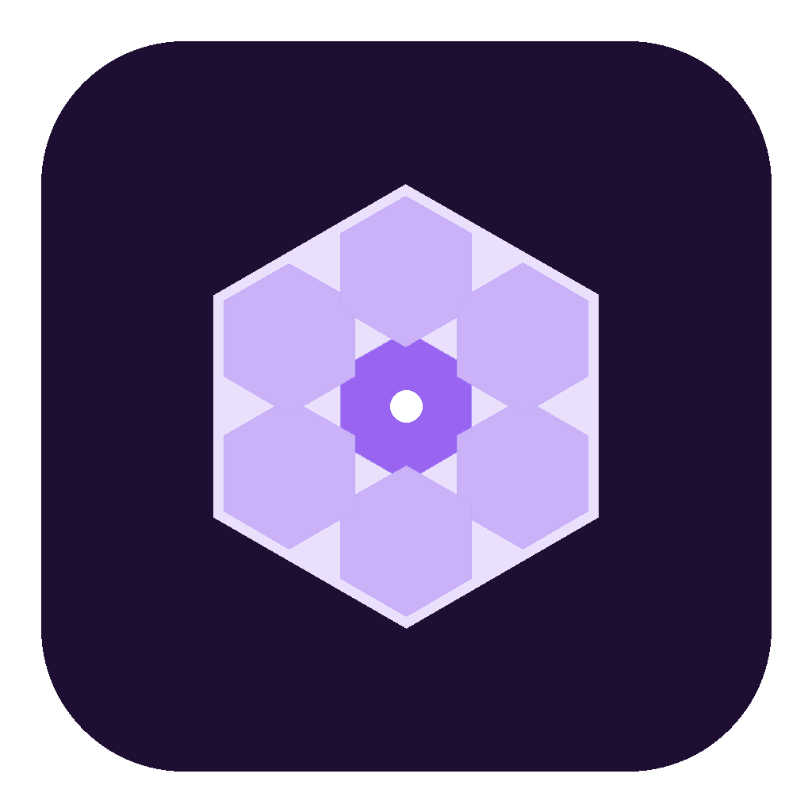
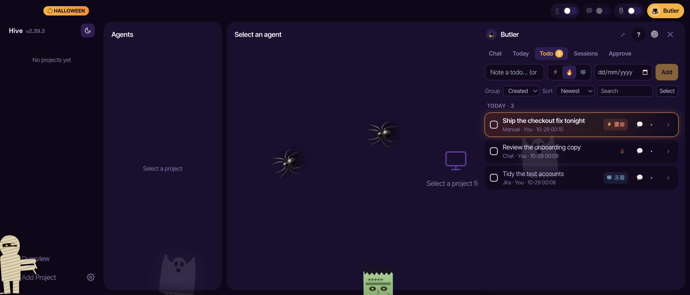

<div align="center">



# Hive

**用 Claude Code 带一支团队，而不是开一堆终端标签页。**

一个 macOS 应用：让多个 Claude Code agent 组成团队，每个都有自己的角色、记忆和工作目录。
可以让一个 manager agent 分派任务；聊天在重启和长时间目标下也不会断；
在手机上就能看团队进度、下指令。

[](https://github.com/nocodevit/hive/releases/latest)
[](https://github.com/nocodevit/hive/stargazers)
[](../LICENSE)

[**下载**](https://github.com/nocodevit/hive/releases/latest) · [功能](#功能) · [最近更新](#最近更新) · [安装](#安装) · [English](../README.md)

</div>

---

## 🎃 万圣节限定皮肤 · 10/24 – 11/2



万圣节期间升级后，Hive 会自动换上夜紫 + 金南瓜的限定皮肤（只换一次），窗口里多了一群"住客"：

- **阿飘**：举着双手把床单撑成帐篷，在窗口里四处飘、忽隐忽现。
- **蜘蛛**：时不时窜进来，停在 Chat 上张望一下，再钻进角落织一张网，网过一两分钟慢慢消失。
- **木乃伊**沿着窗口底边蹒跚走过；**科学怪人**从底边探出半个头，脖子上的螺栓冒电火花。
- 每隔几分钟，**阿飘或南瓜怪**会突然扑到你眼前——南瓜怪还会咬一口。

它们都不挡点击。随时可以在 *Settings › Theme palette* 换回其他主题；11/2 之后会自动换回你原来的配色。打开"减少动态效果"时它们都不动。

## 最近更新

- **2.39** — 动效：发送先转圈再 ✓，卡片滑走、下面的补位；Dismiss / Drop 立刻生效并可**撤销**；Todo 打勾会画出 ✓ 并划掉；Tab、数字、菜单都有动画。飞书卡片会写明是谁发的。南瓜怪。
- **2.38** — 万圣节皮肤。更新窗口会显示**你跳过的每个版本**的说明，而不只是最新一版。语音输入录音条（点按或长按：计时、实时波形、左滑取消）。
- **2.37** — Butler **Todo** 三档优先级（⚡ 要命 雷暴置顶 / 🔥 冒烟 / 🧊 冻着）、多选、*移到明天*。**Discuss** 可以把卡片或 todo 发给 Butler，也能直接发给任何项目的 agent。Butler 可以在聊天里查看、整理审批卡片（但从不替你发送）。

所有版本：[CHANGELOG.md](../CHANGELOG.md) · [Releases](https://github.com/nocodevit/hive/releases)

---

## 为什么用 Hive

同时跑好几个 Claude Code，通常意味着一排终端标签页、每个 agent 都一个样、电脑一重启活就断了。Hive 把它们当成一个团队来管：

- **每个 agent 有分工。** 每个 agent 都是原生的 Claude Code `--agent`，有角色、性格、skills 和独立记忆。写代码的 agent 各有自己的 git worktree，互不冲突。
- **有 manager 来分活。** 任务组里由一个 agent 当 Manager：读你的 todo 清单、提出批次，Worker、QA 和 Critic 去执行。
- **活不会断。** 支持长时间的 `/goal` 循环、自动 compact、额度重置后自动继续；打开 Hive 时，会列出上次退出时还开着的聊天，一键恢复。
- **手机上就能指挥。** 打开 Butler，手机 Claude App 里就会出现「Hive Butler」：问谁在干活、看某个 agent 说了什么、给某个 agent 发消息。不用另装 App。
- **中英文混着说。** 语音输入能听懂一句话里夹杂的中文和英文。

## 功能

### 一支团队，而不是一堆标签页
- 项目分研发和非研发部门；agent 可以分组，拖动排序。
- 8 个角色模板（工程师、产品、QA、设计、市场、运营……），也可以自建；每个 agent 的定义就是一个普通的 `.claude/agents/hive-<id>.md` 文件。
- 每个 agent 单独配置 skills、模型和 effort；每个 agent 有独立的持久记忆，改名也不丢。
- 每个写代码的 agent 有自己的 git worktree（`{repo}-{agent}/`，分支 `hive/{agent}-{id}`），删除 agent 时自动清理；可选重启时自动 rebase。

### 为长时间运行设计的聊天
- 基于 `claude --print --output-format stream-json` 的结构化聊天：工具调用分块显示（Bash、带 diff 的 Edit、Read、Grep、Todo、网页、MCP），subagent 实时时间线，可点击的选项，权限确认。
- 实时显示 context、5 小时和 7 天用量；一键 compact，重会话先 compact 再恢复，额度重置后自动「请继续」。
- `/goal` 的回复渲染成卡片；卡住的 goal 循环可以在输入框里打断、清除。
- 打开 Hive 时列出上次退出（或崩溃）时还开着的聊天，默认全选，一键恢复。

### 任务组
- 共享一份 todo 清单，分 Manager 👑、Worker 🔧、QA 🛡️、Critic ⚖️ 角色。
- 批次提案由你批准（或自动批准），有批次历史、活动日志、卡住检测，可选每日报告。
- staging 分支流程：任务的改动必须 commit、rebase、push 之后才算完成。

### Butler：Hive 里的助理
- **Approve**：Butler 写好的回复（邮件、飞书、Jira）以卡片等你处理——对方说了什么、已经发了什么、草稿。你来发送、修改、讨论或忽略；没有你，Butler 不会发出去。
- **Todo**：它答应跟进的事，每条带完整经过；三档优先级、截止日、多选。
- **Today**：根据日历（飞书和/或 macOS）和例行任务排出的当天计划。
- **飞书代答**（可选）：能用事实回答的就回答并告诉你；需要你拍板的变成卡片，什么都不发。

### 在手机上用 Butler
- App Settings → **Remote Control** → *Allow remote control from my phone (Butler)*，默认关闭。
- Hive 在自己的目录里运行一个开了 Remote Control 的 Claude Code 会话；手机打开 Claude App → **Code** →「Hive Butler」。
- 它能列出 agent 和状态、读某个 agent 的最新输出、把你的话原样发进你点名的 agent 的聊天里。同名时不会乱猜，不会自己启动你没要求的聊天，也不能改文件。（[详细说明](butler-api.md)）

### 语音输入
- 对着聊天框说话，边说边出字；可以设置停顿后自动发送。
- 点一下 🎙 免提听写，或者按住：按钮拉长成录音条，显示计时和实时波形，左滑取消。
- 填入你自己的 OpenAI API key，一句话里中英文混说也能准确识别；不填就用 macOS 本机识别。（[详细说明](voice-input.md)）

### 其他
- 项目面板（从 markdown 里扫出 todo、agent 看板、根据 git 活跃度判断项目阶段）、每个 agent 的工作日志、带 markdown 预览的文件浏览器。
- 主题：紫、蓝、粉三种配色，浅色和深色，还有「Prime」风格，以及季节限定的 🎃 万圣节皮肤。
- 自动更新：*Check for Updates → Install & Restart*，安装前会先校验签名和开发者。（[详细说明](self-update.md)）

## 安装

**要求**
- Apple Silicon 的 macOS。
- 已安装并登录 [Claude Code](https://docs.claude.com/en/docs/claude-code)。Butler（手机控制）需要 claude.ai 订阅账号，并且和手机 Claude App 登录的是同一个账号。

**下载**：在 [Releases](https://github.com/nocodevit/hive/releases/latest) 下载最新的 `Hive-<版本>-arm64.dmg`，打开后把 Hive 拖进「应用程序」。

或者用 Homebrew：
```bash
brew install --cask nocodevit/tap/hive
```

> Hive 已签名，但还没做 Apple 公证。第一次打开时请右键 Hive →「打开」，或者运行 `xattr -cr /Applications/Hive.app`。

### 从源码构建

```bash
git clone https://github.com/nocodevit/hive.git
cd hive
npm install
npm run dev
```

需要 Node.js 20+。`npm test` 跑单元测试，`npm run test:e2e` 跑 Playwright 测试。

## 数据存在哪里

| 数据 | 位置 |
|------|------|
| 项目、agent、设置 | `~/.hive/data.json` |
| agent 定义 | `{项目}/.claude/agents/hive-{agentId}.md` |
| agent 记忆 | `~/.hive/memory/{agentId}/` |
| 聊天记录 | `~/.hive/chat-logs/` |
| 工作日志 | `~/.hive/logs/` |
| Butler 会话目录 | `~/.hive/butler/` |
| Skills | `~/.claude/skills/` |

## 许可

[AGPL-3.0](../LICENSE)：开源，可以随意 fork；分发修改版必须同样开源。商业使用需要授权。
